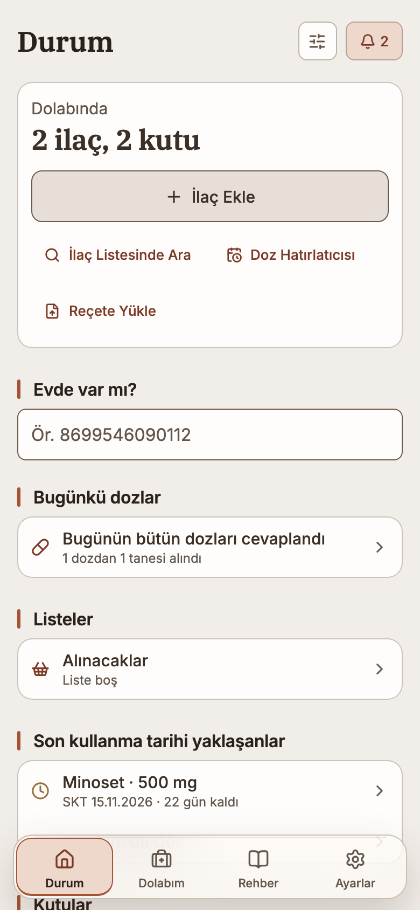
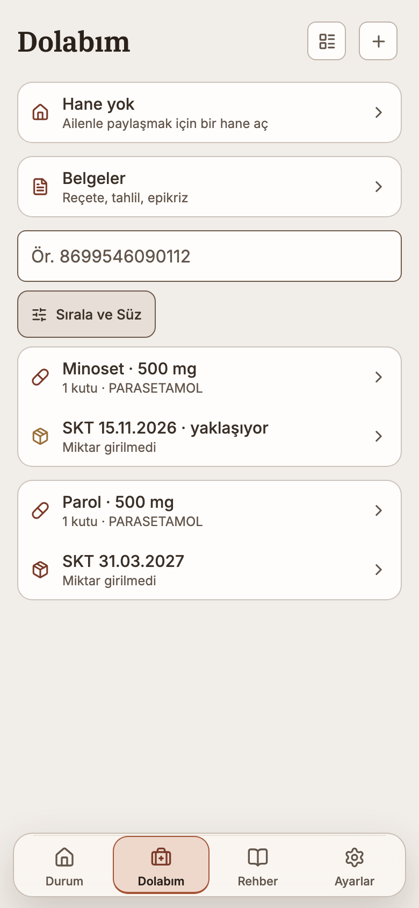
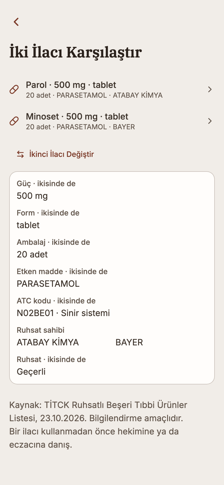

<div align="center">

# Fiala

### Evin ilaç dolabı — kimin, nerede, ne zamana kadar.

**Evdeki kutular, kimin oldukları, son kullanma tarihleri ve stokları;**
**dozlar, reçeteler ve TİTCK listesinden bir ilaç rehberi.**

*A local-first medicine cabinet for a household: the boxes at home, whose they
are, their expiry and stock, dose plans, prescriptions, and a guide over
TİTCK's list with OpenStreetMap's pharmacies. iOS, Android and the web from one
codebase.*

<a href="https://topraksv.github.io/fiala/"></a>

[](https://github.com/topraksv/fiala/actions/workflows/ci.yml)
[](https://docs.expo.dev/versions/v58.0.0/)
[](#geliştirici-kurulumu)
[](LICENSE)

<br>

<p>
  <picture><source media="(prefers-color-scheme: dark)" srcset="assets/screenshots/m-status-dark.png"></picture>
  <picture><source media="(prefers-color-scheme: dark)" srcset="assets/screenshots/m-cabinet-dark.png"></picture>
  <picture><source media="(prefers-color-scheme: dark)" srcset="assets/screenshots/m-compare-dark.png"></picture>
</p>

<sub>Ekran görüntüleri gerçek uygulamadan, tamamı örnek verilerle alındı. Sistem temanıza göre açık/koyu görünür.</sub>

</div>

---

## Fiala ne yapar?

Evdeki ilaçlar bir dolapta, bir çekmecede, bir çantada durur — ta ki birinin
süresi geçene, aynı ilaç ikinci kez alınana ya da gece "bunu kim içiyordu?"
sorusu sorulana kadar. Fiala dolabı evin ortak kaydına çevirir.

Üç cümlede:

- **Ekler.** Kutunun karekodu ya da barkodu ürünü, seriyi, partiyi ve son
  kullanma tarihini doldurur; okunmayanı TİTCK listesinden ya da elle eklersin.
- **İzler.** Son kullanma, açıldıktan sonraki süre ve azalan stok Durum'da
  sayılır; zamanı gelince telefon hatırlatır.
- **Hatırlatır.** Kişi başına doz planı; alındı, atlandı, ertelendi olarak
  kaydedilir, istersen kutudan düşer.

Fiala bir hesapla kullanılır. Kayıtlar yine de **önce cihazda** durur; bulut,
cihazların ve evdekilerin arasını eşitlemek içindir, çalışmanın şartı değil.

---

## Nereye bakacaksın?

| İhtiyacın | Gideceğin yer | Bulacakların |
|---|---|---|
| **Neye dikkat etmeliyim?** | **Durum** | Süresi yaklaşan ve geçenler, azalan stok, bugünün dozları; kartlar sıralanır ve gizlenir |
| **Evde ne var?** | **Dolabım** | Ürününe göre gruplu kutular, kart ya da liste; arama, sıralama ve süzgeçler |
| **Yeni kutu** | **Dolabım → Ekle** | Karekod, barkod, TİTCK araması ya da elle; aynı kutu ikinci kez eklenince uyarır |
| **Bir ilacı tanımak** | **Rehber** | TİTCK listesinde arama, etkin madde ve ATC grubu, KÜB/KT bağlantısı, evdeki kutuları |
| **Yakında eczane** | **Rehber → Eczaneler** | Yakınımdakiler ya da il ve ilçe; telefonda harita, arama, yol tarifi; nöbetçi eczane e-Devlet'te |
| **Doz takibi** | **Durum → Doz Takvimi** | Kişi başına plan, takvim ve hatırlatma |
| **Reçeteler** | **Dolabım → Belgeler** | Fotoğraf ya da PDF; ilaçlara ve kutulara bağlanır |
| **Evdekilerle paylaşmak** | **Ayarlar → Hane** | Davet bağlantısı ya da kodu: yönetici, düzenleyen ya da yalnız gören |
| **Hesap** | **Ayarlar → Hesap güvenliği** | E-posta, şifre, veri sıfırlama, dondurma ve silme |

---

## Neden cihazda?

Her yazma önce cihazdaki SQLite veritabanına iner — veri satırı ve outbox kaydı
**tek transaction** içinde. Uygulama çevrimdışıyken eksiksiz çalışır; bağlantı
geldiğinde outbox Supabase'e gönderilir, hanenin değişiklikleri canlı kanaldan
gelir.

- **Silme geri alınabilir.** Silmeler tombstone'dur, cihazlar arasında tutarlı
  kalır.
- **Bozuk satır kuyruğu tıkamaz.** Reddedilen kayıt karantinaya alınır ve ne
  olduğu Ayarlar'da yazılır; ötekiler gitmeye devam eder.
- **Konum telefondan çıkmaz.** Yakındaki eczaneler için sunucuya bir
  kilometrelik ızgaraya yuvarlanmış bir alan gider, kişinin yeri gitmez.

---

## Platformlar

| Platform | Nasıl açılır | Durum |
|---|---|---|
| **Web** | [topraksv.github.io/fiala](https://topraksv.github.io/fiala/) | `main`'e yapılan push web yüzeyine dokunduğunda otomatik yayımlanır; web'de harita yok, liste ve dış bağlantılar var |
| **iOS / Android** | Expo Go → EAS `preview` update'i | **Fiziksel cihaz kabulü henüz yapılmadı.** Tarayıcı testleri native SQLite, kamera, bildirim, konum ve haritayı kanıtlamaz |

Telefonlar uygulamayı Expo Go'da açar; development client yok ve mobil kullanım
Expo Go'nun SDK 58 ile sunduğu native kütüphanelerle sınırlı. Her sürümün ne
getirdiği [CHANGELOG.md](CHANGELOG.md) içinde.

---

## Tasarım

Fiala, Helix'in ve Gital'ın tasarım dilini taşır: aynı tokenlar, aynı bileşenler.

- **Palet:** ailenin üç paleti, Ayarlar'dan anında değişir; Fiala'nın kendi
  markası ve paleti yolda.
- **Hareket öğededir;** hareket azaltma tercihi hepsini durdurur.
- **Erişilebilirlik ölçülür.** Metin kontrastı iki temada da hesaplanır; her
  dokunma hedefi en az 44 nokta; büyük yazıda kutular sütun bırakır, harf
  bölmez.

---

## Gizlilik ve güvenlik

- **Özel nitelikli veri:** ilaç ve sağlık kaydı KVKK'da özel nitelikli kişisel
  veridir; ilk kutu, aydınlatma metninden ayrı bir açık rıza ister.
- **Yetki sunucudadır:** her tablo RLS ile korunur; bir haneyi yalnız üyeleri
  görür, istemci kontrolü yetki sayılmaz.
- **Anahtarlar:** istemci yalnız publishable anon anahtarı taşır.
- **Dış istekler:** ilaç listesi TİTCK'in, eczaneler OpenStreetMap'in verisidir
  ve Fiala'nın sunucusundan okunur; KÜB/KT, nöbetçi eczane ve harita bağlantıları
  kendi sitelerinde açılır. Kime ne gittiği uygulama içindeki Aydınlatma
  Metni'nde, alıcısıyla birlikte yazılı.
- **Giriş kaydı** cihazın adını tutar (iPhone · Safari), konumunu tutmaz.

---

## Geliştirici kurulumu

> **Node 22 zorunlu** (`.nvmrc`) — Expo SDK 58'in derleyip test ettiği sürüm.

```bash
git clone https://github.com/topraksv/fiala.git
cd fiala
npm ci
cp .env.example .env             # boş bırakılırsa: yerel-yalnız geliştirme derlemesi

npm run web                      # tarayıcıda aç
npx expo start --tunnel --clear  # Expo Go
```

### Kalite kapısı

```bash
npm run verify        # typecheck + dosya başına kapsama eşikli Vitest + lint ratchet
npm run test:e2e      # Playwright: tarayıcı senaryoları
npm run verify:full   # + production export, bundle bütçesi, tüm Playwright
```

`lint-baseline.json` her lint kuralının kaç kez tetiklendiğini kaydeder ve daha
sık tetiklenmesi push'u düşürür. `mutation-baseline.json` kapsamdaki her
dosyanın mutasyon puanını tutar; düşemez.

### Kod haritası

| Klasör | Sorumluluk |
|---|---|
| `src/app/` | Expo Router rotaları ve ekran orkestrasyonu. Yaprak katman: kimse rotaları import etmez |
| `src/domain/` | Saf kurallar. React'sız, testlenebilir |
| `src/data/` | Kalıcılık cephesi ve canlı sorgu hook'ları |
| `src/db/` | Şema, migration'lar, atomik yazma katmanı |
| `src/sync/` | Outbox, birleştirme politikası, karantina |
| `src/auth/` | Oturum, hesap dondurma, giriş kaydı |
| `src/services/` | Yan etkili entegrasyonlar: geri bildirim, paylaşım, cihaz deposu, Rehber |
| `src/ui/` | Tasarım sistemi ilkelleri ve tokenlar |
| `src/i18n/` | Arayüzdeki her metin |
| `supabase/` | Sunucu migration'ları, RLS testleri (pgTAP), geri bildirim fonksiyonu; katalog ve eczaneler `catalogue.yml` ile haftalık yüklenir |
| `tests/<katman>/`, `e2e/` | Birim ve sözleşme testleri kaynağın katman adıyla; tarayıcı senaryoları |

Bağımlılık yönü `app → data → db` ve `app → domain`.

---

## Lisans / License

**Proprietary — all rights reserved.** © 2026 Ömer Toprak Şavlı.

Kaynak; şeffaflık ve inceleme için görünürdür, açık kaynak değildir. Yazılı izin
olmadan çalıştırma, kopyalama, değiştirme, dağıtma veya ticari kullanım hakkı
vermez. Tam koşullar [LICENSE](LICENSE) içinde.
